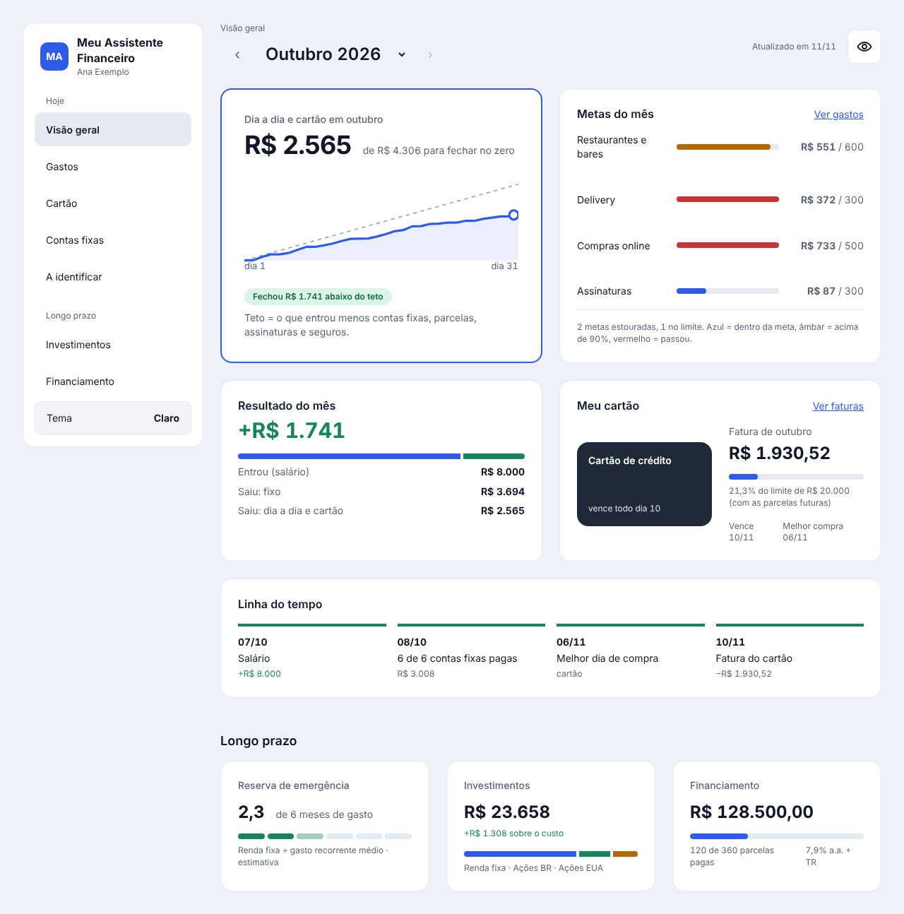
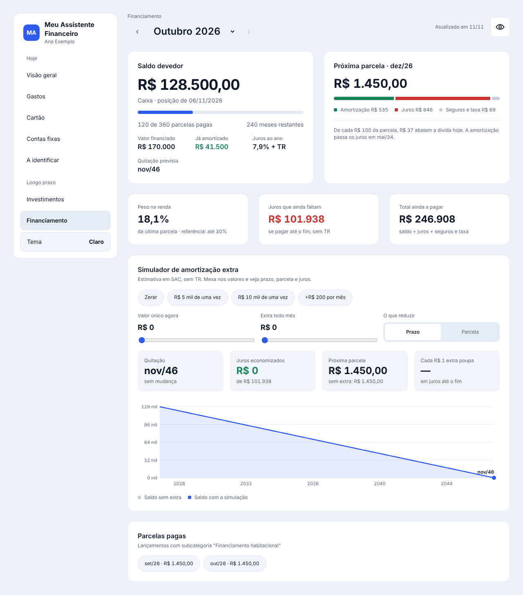
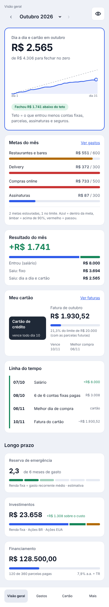

# Meu Assistente Financeiro

Um painel de finanças pessoais que **roda no seu computador**, sem servidor, sem cadastro, sem mensalidade e **sem precisar de IA paga**.

Você baixa o extrato da conta e a fatura do cartão, joga numa pasta, roda um comando, e o painel mostra:

- **Visão geral do mês:** quanto você já gastou no dia a dia contra o teto para fechar no zero, metas, resultado, cartão e uma linha do tempo com salário, contas e vencimentos
- **Resultado do mês:** quanto entrou, quanto saiu e se sobrou ou faltou
- **Gastos por categoria**, com média, metas e os gastos fora da rotina separados
- **Cartão:** faturas, parcelas que ainda vão vencer, limite livre e melhor dia de compra
- **Contas fixas:** o que já foi pago em cada mês
- **Financiamento imobiliário:** saldo, quanto da parcela é juros e um simulador de amortização extra
- **Investimentos:** carteira, resultado e quantos meses a reserva de emergência cobre

Tudo com tema claro/escuro, botão para esconder os valores (para tirar print) e layout que funciona no celular, com barra de abas embaixo.



| Simulador do financiamento | No celular |
|---|---|
|  |  |

> As telas acima usam **dados fictícios** que vêm com o projeto.

## Comece em 3 minutos

1. Instale o [Python 3](https://www.python.org/downloads/). No Windows, marque **"Add Python to PATH"** na instalação.
2. Baixe este projeto: botão verde **Code → Download ZIP**, e descompacte.
3. Abra o arquivo `painel/index.html` no navegador. Ele já abre com os dados de exemplo.

Para usar com os **seus** dados:

```bash
# 1. copie o modelo de configuração e troque o nome, a renda etc.
cp config.exemplo.json config.json          # Windows: copy config.exemplo.json config.json

# 2. crie a pasta do mês e coloque o extrato e a fatura (CSV) dentro
#    entrada/2026-11/extrato.csv
#    entrada/2026-11/Fatura_2026-12-10.csv

# 3. processe
python scripts/processar.py

# 4. abra painel/index.html no navegador
```

O passo a passo completo, com prints, está no **[Manual](docs/MANUAL.md)**.

## Por que existe

Eu queria saber para onde ia meu dinheiro sem entregar a senha do banco para um app e sem montar planilha na mão todo mês. Montei um assistente para mim e resolvi abrir o modelo, com nomes genéricos, para quem quiser usar e adaptar.

## Seus dados ficam com você

- Nada é enviado para a internet. O painel é um arquivo HTML que lê um arquivo do seu próprio computador.
- O `.gitignore` já impede que `config.json`, `entrada/`, `dados/` e a sua carteira subam para o GitHub, se você fizer um fork.
- A única chamada externa é **opcional**: as cotações das ações, pela API gratuita da Alpha Vantage.

## Escolha sua versão

O projeto tem **duas versões**, com o mesmo painel e as mesmas regras:

| | 🆓 Sem IA | 🤖 Com Claude (plano pago) |
|---|---|---|
| Custo | Grátis | Assinatura do Claude |
| Onde roda | No seu computador, sem internet | Na nuvem do Claude |
| Categorizar | Regras em CSV que você ajusta | O Claude pergunta o que não reconhece e grava a regra |
| Holerite e prints do banco | Você digita os números | Você manda o PDF ou o print |
| Rotina do dia 11 | Agendador do Windows ou cron | Tarefa agendada no Claude, mesmo com o PC desligado |
| Painel | Arquivo no computador | Página privada com link, abre no celular |
| Comece por | [Manual](docs/MANUAL.md) | [Manual da versão com Claude](claude/MANUAL-CLAUDE.md) |

Nas duas, **baixar o extrato e a fatura do banco é manual** (cerca de 5 minutos por mês). Veja as [limitações da versão sem IA](docs/MANUAL.md#limitações) e as [da versão com Claude](claude/MANUAL-CLAUDE.md#8-limitações-e-custos).

## Bancos suportados

- **C6 Bank:** extrato da conta e fatura do cartão em CSV, lidos direto.
- **Qualquer outro banco:** converta o extrato para um CSV simples com as colunas `data;descricao;valor` (valor negativo = saída). O manual explica como.

Quer suporte nativo ao seu banco? Abra uma *issue* com um exemplo do CSV (com os valores apagados) ou mande um *pull request*.

## Adaptar e contribuir

Quer mudar o código, criar o leitor do seu banco ou mandar uma melhoria? As regras do projeto estão no **[AGENTS.md](AGENTS.md)**: mapa das pastas, como testar com os dados de exemplo, padrões de código e regras de negócio.

Assistentes de programação com IA (Claude Code, Codex, Copilot, Cursor) leem esse arquivo sozinhos, então basta abrir a pasta do projeto e pedir a mudança. Detalhes e cuidados com seus dados na [seção 15 do manual](docs/MANUAL.md#15-adaptar-o-projeto-ou-contribuir-com-ou-sem-ia).

## Estrutura

```
config.exemplo.json   modelo de configuração (copie para config.json)
regras/               regras de categorização (edite à vontade)
scripts/processar.py  lê os extratos e gera os dados do painel
scripts/cotacoes.py   (opcional) busca cotações das ações
scripts/montar_painel.py  gera o painel num arquivo único (celular, Claude)
painel/index.html     o painel
automacao/            rotina do dia 11 para Windows, Mac e Linux
exemplo/              dados fictícios para testar
claude/               versão com Claude: skill, manual, tarefas agendadas
docs/MANUAL.md        manual completo
AGENTS.md             instruções para agentes de IA que forem alterar o projeto
```

## Licença

MIT: use, copie, adapte e compartilhe. Isto não é recomendação financeira; as projeções (como a do financiamento) são estimativas.

Feito por Leandro Silva, com a ajuda do Claude.
